# QueryAtlas

**Let your AI assistant answer questions from your database, without handing it the keys.**


<p align="center">
  
</p>

## What it does

QueryAtlas sits between an AI assistant and your databases. You ask in plain language; it finds the right
tables, lets the assistant write the query, checks that query, runs it, and shows the answer.

- **It knows your database.** On the first connect it learns the tables, the relationships and what the
  columns hold, so the assistant gets only the few tables a question needs instead of the whole schema.
- **It is read-only by default.** Every query is parsed and checked before it runs: one SELECT, no changes,
  no password columns, a row limit and a time limit.
- **It keeps clients apart.** In a database shared by many customers, every query is filtered to one
  customer by the server, whatever the query says.
- **It records everything.** Who asked, what ran, how many rows, how long: one line per query in the
  audit log.

Works with SQL Server, PostgreSQL, MySQL and MariaDB, SQLite, MongoDB and Cassandra. Use it from Claude
Code, Claude Desktop or Cursor, or through the included web app for people who never see SQL.

<p align="center">
  
</p>

## Quick start

```
git clone https://github.com/Machi2130/QueryAtlas.git
cd QueryAtlas
pip install -r requirements.txt
cp .env.example .env            # optional: an API key, saved database passwords
python mcp_server.py --install  # registers the server with Claude Code
```

Restart Claude Code and ask:

> connect to the SQLite file sales.db and show the ten biggest customers by revenue

If the connection needs a password, a form asks for it. The password goes straight to the server and never
through the chat.

## Safety, in short

- Read-only unless a developer switches writes on, and then every change is shown in full and needs a
  typed YES.
- Credentials are never stored, logged or shown. Connections to hosted databases are always encrypted
  with the certificate checked.
- Each person has their own identity, their own connections and their own learned knowledge, even on a
  shared server.
- The validator was reviewed externally three times before the first release, and every finding was
  reproduced before it was fixed.

For real protection, give the server a read-only database login. The validator is the second line of
defence, not the first.

## For a team

Run it once on a server inside your network and let colleagues connect with one command; nobody installs
Python or drivers. See [the guide](docs/GUIDE.md#hosting-it-for-a-team).

## Learn more

- [Guide](docs/GUIDE.md): how questions are answered, every tool, teaching it about your data, tenant scope,
  developer writes, hosting, troubleshooting, settings.
- [Architecture](docs/ARCHITECTURE.md), [security model](docs/SECURITY.md),
  [example sessions](docs/EXAMPLES.md), and the [decision records](docs/decisions/) that explain why
  things are built the way they are.
