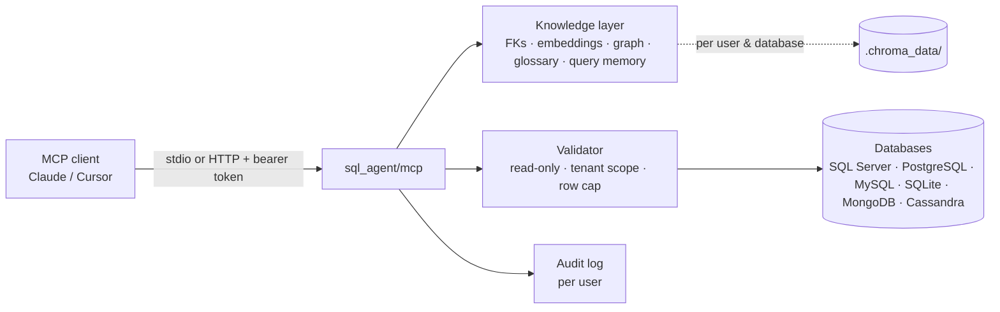
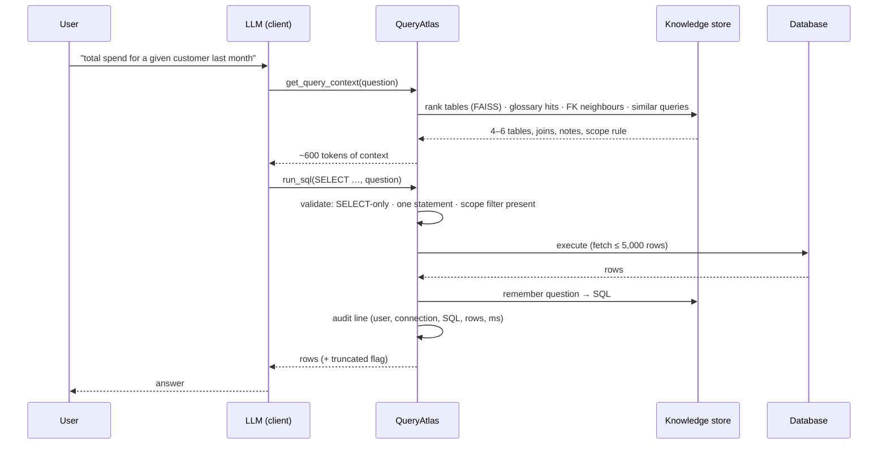
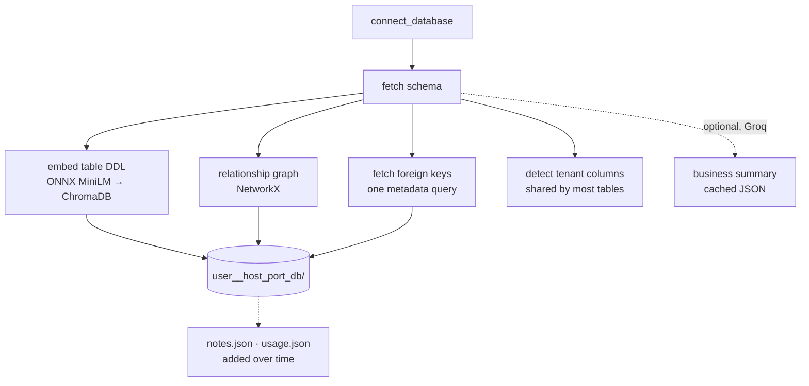

# Architecture

QueryAtlas is an MCP (Model Context Protocol) server. The client — Claude Code, Claude
Desktop, Cursor — brings the language model; this server brings governed access to
databases plus the knowledge the model needs to query them well.

## Request flow

1. **`connect_database`** opens a connection (or switches to one already open — several
   stay open side by side), fetches the schema and the real foreign keys, and builds the
   knowledge layer for that user + database: table DDL embeddings (ONNX MiniLM, in
   ChromaDB), a NetworkX relationship graph, and — if a Groq key is present — a one-off
   business summary cached as JSON. Multi-client databases are detected (a column shared by
   most tables) and reported as `scope_candidates`.
2. **`get_query_context(question)`** returns only what the question needs: 4–6 ranked
   tables with columns, join paths (FKs first, then graph, then `x_id → x.id` inference),
   glossary notes for those tables, hot tables, similar past question→SQL pairs and the
   active tenant scope. About 700 tokens regardless of schema size (measured: 67% less than
   the full schema at 42 tables, 89% at 120, 97% at 300); each result reports `context_tokens`.
3. The client's model writes SQL; **`run_sql(sql, question)`** validates it (parsed per
   dialect: one read-only statement, every table known), applies the tenant scope by
   rewriting, executes with a row cap, audits it, and remembers the question→SQL pair as
   unverified. **`mark_query`** records the user's verdict: verified example or deleted.
   Database errors come back with the next step (e.g. the real columns of the tables used).
4. **`execute_write`** (developer mode only) runs one INSERT/UPDATE/DELETE after the human
   confirms it in a form; `dry_run` reports affected rows and rolls back.

One question, end to end:

Knowledge build on first connect (no LLM tokens unless a Groq key is set):

## Modules

| Module | Responsibility |
|---|---|
| `sql_agent/mcp/` | The MCP product. `catalog.py` holds the tool definitions as data; `handlers/` has one module per concern (connect, query, writes, knowledge, documents, capabilities); `runtime.py` is the injectable object every handler depends on (policy, connection store, live sessions, the ports to the outside); `server.py` wires the MCP `Server`, the permission check and dispatch; `transport.py` is Streamable HTTP + OAuth 2.1 PKCE; `install.py` the command line. `sql_agent/server.py` is the facade at the old import path |
| `sql_agent/web/` | The web product. `create_app()` assembles `routers/` (auth, connections, query, sessions, settings, llm, documents); `pipeline.py` is the one path a question takes behind `/api/query`, `/api/query/stream` and `/api/hybrid`; `deps.py` holds the request helpers (permissions, what a viewer may see, the active connection, the tenant-scope gate); `runtime.py` the injectable collaborators. `sql_agent/app.py` is the facade |
| `sql_agent/config.py`, `state.py`, `ports.py` | Every setting in one place; the per-connection state and its store, shared by both products; the protocols the runtimes' ports satisfy |
| `sql_agent/profile/` | **What the agent knows about a database**, built the same way for every one (below) |
| `sql_agent/prompts.py` | `build_sql_messages` (the only prompt builder for server-side SQL), connect-time analysis, auto-fix |
| `sql_agent/validation.py` | Read-only validator, parsed per dialect (sqlglot) |
| `sql_agent/sqlreview.py` | Reviews generated SQL. Applies same-rows date rewrites (`YEAR(col)=y` becomes a range; on SQLite only when the range keeps 15% of rows or fewer, because measured on 4.5M rows a 27% range was 4x slower). Flags fan-out (including two sibling many-side tables), a LEFT JOIN undone by its WHERE, ranking without ORDER BY, and unknown columns, and gives each one repair round with the reason. On large tables it also notes `select_star` and `non_sargable`. It never suggests correlated EXISTS on SQLite (measured 46x slower there) |
| `sql_agent/scope.py` | Tenant scope: `SCOPE_PINS` and enforcement by rewriting every scoped table |
| `sql_agent/database.py` | Engines; schema, foreign-key and primary-key reading; row serialization |
| `sql_agent/retrieval.py` | Embeddings, `SchemaRetriever` (FAISS + BM25), column ranking |
| `sql_agent/llm.py` | `LLMClient`: any OpenAI-compatible API, retries 429/503 |
| `sql_agent/presentation.py` | Plain-language answers, chart choice, friendly messages |
| `sql_agent/knowledge.py` | `KnowledgeEngine`: ChromaDB store (DDL, docs, verified/unverified queries) |
| `sql_agent/query_planner.py` | Intent and time-range detection |

### The database profile (`sql_agent/profile/`)

Built at connect from the catalog alone, stored as `profile.json` in the database's
knowledge folder, reused while the schema fingerprint is unchanged. Nothing in it knows
about any particular database.

| Module | Responsibility |
|---|---|
| `models.py` | `DatabaseProfile`, `TableProfile` (role: lookup / header / detail), `ColumnProfile` (key / category / number / date), `Relationship` (declared or inferred, many-to-one) |
| `builder.py` | `ProfileBuilder`: relationships from declared FKs, then same-name-as-primary-key (legacy `CUST_NO` style), then `x_id` (word-indexed, so thousands of tables cost one lookup per column); a guess must point at the target's key and **the data must confirm it** (`JoinChecker`: at least 80% of sampled values found in the target). `ProfileStore`: JSON + fingerprint |
| `graph.py` | `SchemaGraph`: weighted adjacency list (declared 1, guessed 3), Dijkstra with a heap, Steiner-tree heuristic (Takahashi–Matsuyama, best of all roots) to join the chosen tables in any number of hops |
| `sampler.py` | `ValueSampler`: one bounded sample per table, the first time a question touches it: category values, numeric / date ranges. Keys, contact and secret-like columns are never listed. `PROMPT_VALUE_HINTS=false` turns it off. `JoinChecker`: the data's verdict on a guessed join, one column per task, parallel on remote engines |
| `service.py` | `ProfileService`: owns a profile per connection, lazy and thread-safe sampling, persistence. Backup/dated **copies** of a table are recognised from structure (same name minus stamps, same columns) and hidden unless asked for. `learn_joins`: for the tables a question needs that the graph cannot connect, finds text-identifier joins in the data (no name needed) and keeps them in the profile |
| `context.py` | `ContextAssembler`: question → candidate tables (the retriever's ranking fused with word matches on names, descriptions and columns, copies hidden) → **catalog** (one line per table) → join tree → annotated columns. A chosen table is never dropped for lack of a join |

### Bring your own AI

Each web user can pick a provider (Groq, OpenAI, OpenRouter, Ollama on the server), an API key and a model, and
optionally a second model for choosing tables, in the page's 🤖 panel (`/api/llm`, needs `connect`). Addresses are
fixed per provider, so nobody can make the server call an address of their choosing; only `settings.manage` may use a
custom one. The key is held in the server's memory (`app._llm_settings`), never in the session store, Redis, a file or a
log, never returned by any route, and scrubbed from provider errors. `/api/llm/models` lists a provider's models and
`/api/llm/test` tries the key and model with one tiny request. Without their own settings a user falls back to the
server's `LLM_API_KEY`, if there is one. The MCP server keeps a key passed to `connect_database` in memory the same way.

### Choosing the tables

Code alone cannot tell that "staff department" means the RBAC users table or that "billing" has no
table. So: the catalog (one line per table: name, what it is, first columns; about 1.5k tokens for
50 tables, narrowed to the best 60 for larger databases) goes to a model, `prompts.pick_tables`,
which returns the tables and the parts of the question no table covers (`TABLE_PICKER=false` turns
it off, `PLANNER_MODEL` picks a different model than the SQL writer). Code checks the names,
adds the join path, and keeps every picked table. Answers are cached per database. MCP gets the same
catalog in `get_query_context` (`other_tables`) so the calling model can ask for any table with
`get_schema`, which also returns the joins among the tables asked for. Measured on 65 TBO tables,
6 questions, 15 needed tables: code-only slice 10/15 (was 8/15), live picker 13/15, catalog
contained 15/15.

When an answer is wrong, fix the knowledge (a glossary note, a confirmed answer, a better
relationship rule), not the prompt for one database. Measured on two unlike databases
(declared FKs vs none at all): 11/11 live answers matched hand-written SQL, 2026-10-20.
| `sql_agent/docstore.py` | Uploaded documents: chunking, embedding, hybrid search |
| `sql_agent/cache.py` | Sessions, schema cache, query cache, rate windows and recent turns behind one `CacheBackend` protocol: Redis when configured, else a bounded in-process store |
| `docs/decisions/` | Architecture decision records: the choices a future change could undo without knowing why |
| `sql_agent/storage.py`, `auth.py` | Memory persistence and web-app auth (only used by the companion UI) |
| `mcp_server.py` | Root launcher: `python mcp_server.py [--http host:port]` |
| `tests/test_eval.py` | Benchmark on a fixture DB: retrieval recall/precision, clarify, safety, execution accuracy for any model's SQL (`--predictions`) or Groq (`--groq`) |
| `tools/export_training_data.py` | Verified question→SQL pairs + table DDL → fine-tuning JSONL (eval questions held out) |

## Keys and isolation

- **Connection key** = `session + host + port + database` (hashed when long). Engines,
  schema, retriever, FKs, scope and knowledge handle hang off it; a session's *current*
  connection is a pointer, so switching never reconnects.
- **Knowledge key** = `user + host + port + database`. Everything learned — embeddings,
  glossary notes, remembered queries, usage counts — is private to the user who learned it
  (user = token name over HTTP, `MCP_USER_ID` locally).
- **Documents** (`upload_document`) are per user, not per database.

## Transports

- **stdio** (default): one process per client, launched by the MCP host.
- **HTTP** (`--http host:port`): Streamable HTTP at `/mcp`, bearer tokens from
  `MCP_AUTH_TOKENS` (one per person) checked in plain ASGI (no redirects, constant-time
  compare); each client gets its own session from the transport's `Mcp-Session-Id`.

## Decisions worth knowing

- **ONNX embedder instead of sentence-transformers/torch** — same `all-MiniLM-L6-v2`
  vectors, 750 MB less install, 3× faster startup.
- **Table ranking uses FAISS, not ChromaDB's index** — Chroma's HNSW segment is not
  persisted for collections under ~100 records (i.e. every real schema), so a query from
  a fresh process could fail silently. Chroma still stores DDL/docs/query memory.
- **Connections are never closed on switch** — developers work across several databases;
  `disconnect` closes only the current one.
- **Writes require a human** — the model cannot approve its own statement; without a form
  the write is refused.
