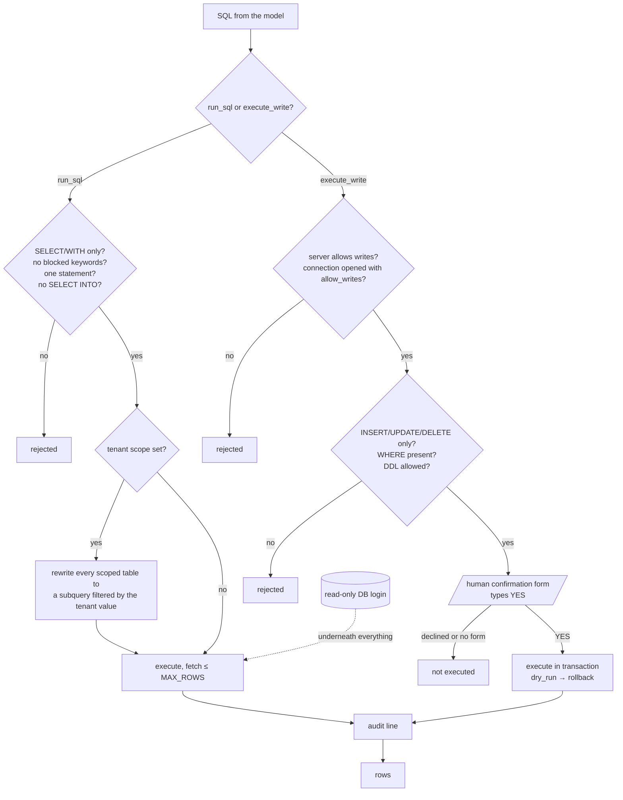

# Security model

The server sits between an AI model and real databases. The model is treated as an
untrusted author of SQL; everything below exists to make that safe.

## 1. The database login is the real guarantee

Run the server with a **read-only login** (`db_datareader` on SQL Server, a read-only role
elsewhere). The SQL validator is the second line of defence, not the first. Script for SQL
Server in the README. Never run the server under a sysadmin or database-owner account.

## 2. Read-only validator (`validate_sql`)

Applies to `run_sql` and the Groq path:

- parsed with sqlglot in the connection's dialect; unparseable SQL is rejected;
- exactly one statement, and it must be a SELECT or a UNION/INTERSECT/EXCEPT of SELECTs
  (WITH allowed); no INSERT/UPDATE/DELETE/MERGE/DDL/GRANT node anywhere in the tree,
  including inside a CTE;
- `SELECT … INTO` is rejected (it creates a table);
- every table reference at any depth (comma joins, subqueries, CTE bodies) must be in the
  learned schema or a CTE of the same statement; columns named like secrets (`password`,
  `token`, `hash`…) are blocked as columns, not as words in string literals;
- second line: blocked keywords outside string literals: `INSERT UPDATE DELETE MERGE DROP
  ALTER CREATE TRUNCATE EXEC EXECUTE GRANT REVOKE DENY xp_* sp_* OPENROWSET OPENQUERY
  OPENDATASOURCE BULK DBCC BACKUP RESTORE SHUTDOWN RECONFIGURE WAITFOR`;
- the user's question wording never licenses a write (an earlier version allowed a keyword
  if the question mentioned it — removed).

## 3. Row cap

`run_sql` fetches at most `MCP_MAX_ROWS + 1` rows (default 5,000) and flags `truncated`;
a `SELECT *` on a 50-million-row table cannot exhaust the server's memory.

## 4. Tenant scope

Many databases hold several clients in the same tables (`Tenant_Id`, `Client_Id`…). The
server detects such columns and, once `set_scope(column, value)` is called for a
connection, **enforces** it: every reference to a scoped table, at any depth, is rewritten
to `(SELECT * FROM t WHERE "col" = 'value')` under the same alias before the query runs.
The model's own WHERE clause is irrelevant — `WHERE Tenant_Id <> 7`, `OR 1=1`, a subquery,
a CTE or a UNION all still see only that client's rows. The value is emitted as an escaped
string literal per dialect (MySQL backslashes included), so a crafted scope value cannot
inject SQL. A CTE that shadows a scoped table's name fails closed (the database rejects the
rewritten query) rather than leaking. Changing the scope clears cached answers. Clearing
the scope is explicit. Mixing clients by accident is the most expensive wrong answer this
tool could give; it is prevented, not warned. Tests: `tests/test_mcp_run_sql.py`
(`test_scope_*`).

**Who decides the tenant.** `set_scope` is called by the model, so on a shared instance
pin each person instead: `SCOPE_PINS=alice:Tenant_Id=7` (identity = bearer-token name over
HTTP, or the web app's user id). A pinned scope is applied on connect and `set_scope` cannot
change or clear it. Over stdio the identity is `MCP_USER_ID`, which the user sets
themselves, so pins only bind hosted (HTTP) and web users.

**Roles and access (both web app and MCP).** Who may do what is a settings file
(`config/rbac.json`, edited from the admin Settings page), not code. The code checks named
permissions (`ask`, `view.sql`, `connect`, `sql.write`, `settings.manage`, ...); the file maps
roles to permissions and people to roles, re-read on every change. Enforcement is
server-side: answers to roles without `view.sql` carry no SQL, tables used or technical
errors (cached answers included); endpoints and MCP tools without the permission return
403 / AUTH_FAILED and are audited. Without `feedback.approve` a 👍 is only a suggestion.
`RBAC_ADMINS` in `.env` always has a settings-managing role, and a settings change that
would leave no role with `settings.manage` is refused.

**Idle lock in MCP too.** The same `idle_lock_minutes` applies to MCP connections opened
with a password: the next tool call shows a password form and verifies it by a real
login. Note: the MCP spec says servers should not ask for sensitive data through
elicitation forms; connect_database already did, and the lock follows the same pattern.

**Several databases, one session (web app).** Each open database is its own connection
(own engine, knowledge folder, cache, chat history); a conversation stays on the database
that answered its first question. A database opened with a password and unused for
`IDLE_LOCK_MINUTES` (default 30) refuses questions with HTTP 423 until the password is
re-entered. The re-entered password is checked by a real login with the saved connection
details; passwords are never stored, and only host / user / database name are kept so a
conversation can reconnect. Unlock attempts share the user's rate limit.

**Every execution path** goes through the same `validate_sql` + `apply_scope` gate: MCP
`run_sql`, `query_database` (including its auto-fix retry), `explain_query`, and the web
app's `/api/query`, `/api/query/stream`, `/api/hybrid` and `/api/query/explain`
(`EXPLAIN ANALYZE` executes the statement on PostgreSQL, so explain is validated too).
The web app also caps rows at `MAX_ROWS`. Tests: `tests/test_web_app.py`.

## 5. Developer writes (`execute_write`)

Three independent gates, all required:

1. an admin enables data writes in **Settings → Database writes**, and the user's role
   includes `sql.write`;
2. the connection was opened with `allow_writes=true` using the developer's own
   write-capable credentials;
3. a human types **YES** in a confirmation form showing the exact statement and database —
   the model cannot approve it, and a client without forms cannot write at all.

`MCP_ALLOW_WRITES` and `MCP_ALLOW_DDL` are first-run defaults; admins manage the live values
in Settings without editing environment files or restarting. DDL has a separate Settings
toggle and should remain off unless explicitly required. Role and server-setting changes
are enforced on subsequent requests, rechecked after confirmation and before commit, and
connected MCP clients are notified to refresh their tool lists. `UPDATE`/`DELETE` without
`WHERE` are rejected; `dry_run=true` runs in a transaction and rolls back; the query cache
is cleared after a write.

## 6. Audit

Every `run_sql`, `query_database`, `execute_write`, note and scope change appends a JSON
line to `audit.log`: timestamp, user, connection, SQL, rows, duration, outcome, reason.
Give each person their own token so "user" is a name.

## 7. Authentication and isolation (hosted mode)

- Bearer tokens (16+ random chars) per person in `MCP_AUTH_TOKENS`; compared in constant
  time; checked before any routing, so no redirect can bypass it.
- Each person's knowledge (embeddings, notes, query memory, usage) is isolated by token
  identity. A shared token collapses all users into one identity and must not be used.
- Put HTTPS in front (Caddy/nginx) wherever the server is reachable beyond a trusted LAN.
- Revoke by removing the token line and restarting.

## 8. Secrets

`.env` is git-ignored and never read by the agent; passwords reach the server through the
connection form (client → server only, never through the model's context) or through
`MCP_DB_PASSWORD[_<DB>]` on the host. Nothing secret is logged — the audit log records SQL,
not credentials.

## Known limits

- A query that hits the client-side timeout keeps running on the database server.
- Elicitation (the confirmation/connection form) requires an MCP client that supports it
  (Claude Code ≥ 2.1.76); older clients get a clear "pass the fields as arguments" error
  for connections and are refused for writes.
